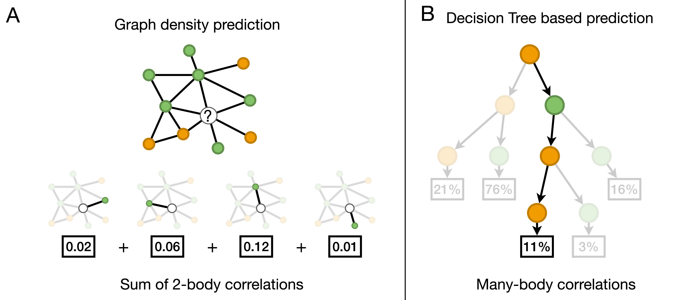
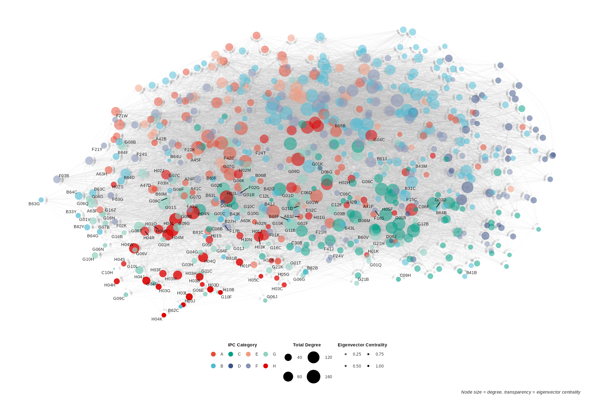
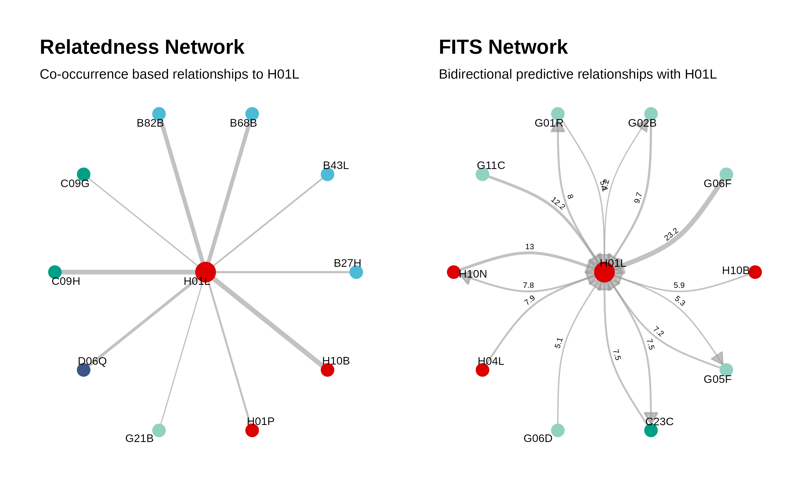
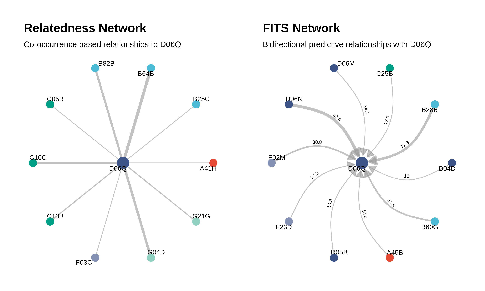
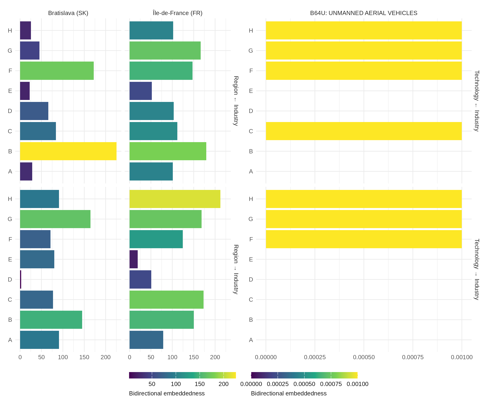

# The interconnectedness between regions and technologies {#sec-meth}

## Methodological motivation {#sec-meth-motivation}

Traditional relatedness frameworks model diversification through symmetric co-occurrence matrices and linear aggregation of relatedness density [@hausmann2011network].
However, as established in our problem statement, these constructs suffer from three structural limitations: (1) symmetry assumptions that obscure directional dependencies between technologies, (2) linear aggregation that loses granular information about technology-specific requirements, and (3) noise when technologies outnumber regions.

We address these limitations by replacing traditional measures with a machine learning training strategy based on the Random Forest algorithm (RF).
Specifically, we use RF to generate: (1) **Feature Importance Technology Space (FITS)** following @fessina2024identifying, analogous to the mainstream Technology Space.
FITS captures directional, hierarchical technology relationships, replacing symmetric relatedness measures; and (2) **predicted probabilities (technological potential)** following @albora2023product, analogous to relatedness density.
The technological potential estimates region-specific feasibility of technology adoption given the region's own technological portfolio, replacing linear relatedness density.
This approach enables the contextualization of diversification strategies by accounting simultaneously the heterogeneity in technology-specific characteristics, regional knowledge infrastructure, and the broader non-linear interconnectedness between regions and technologies that traditional measures cannot adequately capture.

Before detailing our methodology and how we leverage the contributions in @fessina2024identifying and @albora2023product, we will briefly situate this approach within the REC literature.
Essentially, REC formalizes the empirical observation that shared input requirements (knowledge, resources, capabilities) determine diversification feasibility [@hidalgo2018principle; @hidalgo2021economic].
While this framework have proven valuable for policy [@zaccaria2018integrating; @albora2021economic], deriving granular, context-specific implications remains challenging [@hidalgo2023policy; @li2024evaluating].
Recent work on unrelated diversification [@pinheiro2022time; @boschma2023role], geographic inequalities [@pinheiro2025dark; @hartmann2017linking], and emerging technologies [@lee2018early; @fessina2024identifying] highlights the need for methodologies that capture contextual nuances beyond path dependency identification which we will elaborate on in subsequent sections.

@tbl-meth-roadmap summarises how the chapter proceeds.

| The chapter asks | Because the literature shows | And answers with |
|---|---|---|
| How does the mainstream measure relatedness? | Co-occurrence underpins the technology space and diversification policy alike | @sec-meth-mainstream: the measures and their aggregation into density, our benchmark |
| Why is that not enough? | Estimates are noisy, nestedness dominates, symmetry hides hierarchy, linear sums discard interactions | @sec-meth-cooccurrence-limits and @sec-meth-density-limits: the structural limitations |
| How else can feasibility be measured? | Feasibility depends on the whole portfolio, not on pairs | @sec-meth-ml-approach and @sec-meth-potential: Technological Potential |
| How else can relationships between technologies be measured? | Direction is expected in theory but absent from symmetric measures | @sec-meth-fits: FITS |
| What remains uncaptured? | Regions with equal feasibility can differ in how their knowledge base is structured | @sec-meth-coherence: Coherence |

: Roadmap of the chapter {#tbl-meth-roadmap}

Our approach is a response to the nuances expressed in the literature.
But in order to properly situate our contribution we must first elaborate on the mainstream approach conceptually, methodologically and its empirical implications which we briefly outlined in the introduction.
From there we expand on the mainstream approach and present our alternative constructs conceptually and mathematically, and showcase our training strategy.
To this end, we also provide a brief example on how the mainstream approach and the machine learning approach to modeling the technology space compare.
For the sake of clarity and consistency we will establish our notation system and the main definition in this paragraph and use them in the subsequent sections and chapter in this dissertation unless we specify otherwise.

We consider the following sets:

-   $\mathcal{T} = \{\,t : 1 \le t \le N_T\}$: set of technologies
-   $\mathcal{R} = \{\,r : 1 \le r \le N_R\}$: set of regions
-   $\mathcal{Y} = \{\,y : 1 \le y \le N_Y\}$: set of years
-   $\mathcal{C} = \{\,c : 1 \le c \le N_C\}$: set of technology categories^[we refer to categories, domains, industries interchangeably in this work]
-   $\mathcal{K} = \{\,k : 1 \le k \le N_K\}$: set of countries

where $N_T$, $N_R$, $N_Y$, $N_C$, and $N_K$ denote the total number of technologies, regions, years, technology categories, and countries respectively.

We quantify regional specialization using the Revealed Comparative Advantage [@balassa1965rca].
Although originally designed for trade data, this metric has been widely adopted in innovation geography literature.
Following the nomenclature in @balland2017geography, we refer to it as Revealed Technological Advantage (RTA) in our patent data context.
The RTA measures relative specialization, enabling simultaneous capture of expertise depth and portfolio diversity.

The RTA for region $r$ in technology $t$ during year $y$ is defined as:

$$
\text{RTA}_{r,t,y}
= \frac{\displaystyle\frac{X_{r,t,y}}{\sum_{t'} X_{r,t',y}}}
       {\displaystyle\frac{\sum_{r'} X_{r',t,y}}{\sum_{r',t'} X_{r',t',y}}}
= \frac{X_{r,t,y}\,\sum_{r',t'}X_{r',t',y}}
       {\bigl(\sum_{t'}X_{r,t',y}\bigr)\,\bigl(\sum_{r'}X_{r',t,y}\bigr)}
$$ {#eq-rta}
Where, $X_{r,t,y}$: patent count for region $r$ in technology $t$ during year $y$

For each year $y$, we construct the RTA matrix $\mathbf{R}^{(y)}$ with entries $\text{RTA}_{r,t,y}$:

$$
\mathbf{R}^{(y)}
= \bigl[\text{RTA}_{r,t,y}\bigr]_{r=1,\dots,N_{R}}^{t=1,\dots,N_{T}}
$$ {#eq-rta-matrix}

These yearly matrices form the foundation for all subsequent modeling.
We then binarize specialization for classification tasks:

$$
z_{r,t,y}
\;=\;
\begin{cases}
1 & \text{if }\text{RTA}_{r,t,y}\ge1 \\
0 & \text{otherwise}
\end{cases}
$$ {#eq-z}

where $z_{r,t,y} = 1$ indicates region $r$ has comparative advantage (specialization) in technology $t$ at year $y$.

## The mainstream approach {#sec-meth-mainstream}

### Relatedness through co-occurrence {#sec-meth-cooccurrence}

The REC literature operationalises relatedness through the observed frequency of co-occurrences.
The intuition is appealingly simple: technologies that frequently appear together--whether in the same patent, the same firm, or the same region--likely share underlying knowledge requirements.
If mastering one technology facilitates developing another, we should observe them co-located more often than chance would predict.
This reasoning has proven influential, providing the empirical foundation for technology space visualisations and diversification recommendations across academic and policy settings.
All measures in this section are taken from the existing literature; we present them as the benchmark for our approach.

Yet the inference from co-occurrence to capability-based relatedness rests on assumptions that warrant scrutiny.
Co-occurrence is a frequency measure; it tells us how often two technologies appear together, not why they do so or whether that co-presence reflects shared inputs, complementary applications, or statistical artefact.
The distinction matters: a measure intended to guide capability-building strategies must capture genuine knowledge relationships rather than patterns that emerge from data structure alone.

Let $c_{t,t'}$ denote the count of patents containing both technologies $t$ and $t'$ (where $t \neq t'$) within a given time period, and let $c_t$ and $c_{t'}$ denote the total patent counts for each technology individually.
The simplest relatedness measure would be $c_{t,t'}$ itself, but raw co-occurrence counts are problematic: frequently patented technologies will naturally co-occur more often simply due to their prevalence.
Various normalisation schemes address this issue.

**Association Strength** compares observed co-occurrence to expected co-occurrence under independence:

$$
\phi_{t,t'}^{\text{assoc}} = \frac{c_{t,t'} \cdot T}{c_t \cdot c_{t'}}
$$ {#eq-assoc}

where $T = \sum_{t \in \mathcal{T}} c_t$ is the total patent count.
Values exceeding one indicate that the technologies appear together more frequently than would be expected if their occurrences were independent--they are positively associated.
This measure properly corrects for size effects: a rare technology and a common technology can still exhibit strong association if they co-occur more than their marginal frequencies would predict.

**Cosine Similarity** offers a set-theoretic alternative:

$$
\phi_{t,t'}^{\text{cosine}} = \frac{c_{t,t'}}{\sqrt{c_t \cdot c_{t'}}}
$$ {#eq-cosine}

This measures relative overlap between technology profiles.
While intuitive, it systematically favours frequent technologies over rare ones and does not properly correct for size effects, making comparisons across technologies with different prevalences problematic.

**Minimum Conditional Probability** [@hidalgo2007product] takes a different approach: it measures co-location across regions rather than co-occurrence within patents.
For this measure the counts are taken over regions, using the binary specialisation indicators $z_{r,t,y}$ defined in @eq-z (the year index is dropped for readability):

$$
c_{t,t'} = \sum_{r \in \mathcal{R}} z_{r,t}\, z_{r,t'}, \qquad c_t = \sum_{r \in \mathcal{R}} z_{r,t}
$$ {#eq-mcp-counts}

so that $c_{t,t'}$ is the number of regions specialised in both $t$ and $t'$, and $c_t$ is the number of regions specialised in $t$.
The share of regions specialised in $t'$ that are also specialised in $t$ is the conditional probability $P(t \mid t') = c_{t,t'}/c_{t'}$, and the measure keeps the smaller of the two directions:

$$
\phi_{t,t'}^{\text{min}} = \min\left\{\frac{c_{t,t'}}{c_t},\; \frac{c_{t,t'}}{c_{t'}}\right\} = \frac{c_{t,t'}}{\max(c_t,\, c_{t'})}
$$ {#eq-mcp}

The measure therefore normalises co-location by the ubiquity of the more widespread technology, which prevents a technology present in many regions from appearing close to every other technology.
Unlike association strength, it involves no null model: observed co-location is not compared with what independence would predict.
Because it is defined on counts of specialised regions, it requires the binarised indicator rather than the continuous RTA.
Finally, the minimum makes the measure symmetric by construction ($\phi^{\text{min}}_{t,t'} = \phi^{\text{min}}_{t',t}$), so it cannot represent a directional relationship between two technologies; this limitation is discussed below and motivates the directed network in @sec-meth-fits.

A clarification is warranted here regarding two distinct but often conflated concepts.
Co-occurrence typically refers to technologies appearing together within the same patent or firm, while co-location refers to technologies appearing together within the same region.
Both capture related but different phenomena: co-occurrence within patents reveals direct technical complementarities, while co-location within regions reveals shared capability requirements that may operate at greater conceptual distance.
The literature sometimes uses these terms interchangeably, but the distinction matters for interpreting what relatedness measures actually capture.

### Structural limitations of co-occurrence-based relatedness {#sec-meth-cooccurrence-limits}

Despite the variety of normalisation approaches, co-occurrence-based relatedness measures share structural limitations that affect their reliability and interpretation.

**Dimensional mismatch produces noisy estimates.**
The reliability of frequency-based measures depends on having sufficient observations to estimate co-occurrence patterns accurately.
In typical applications, the number of technologies substantially exceeds the number of locations--estimating a matrix of several thousand technology pairs from fewer than two hundred country observations, for instance, produces correlation structures that are largely random [@tacchella2023relatedness].
The number of observations required for reliable estimation of such matrices easily reaches tens of thousands [@bun2017cleaning], far exceeding available data.
This problem is not resolved by moving to subnational levels, where harmonised data is often unavailable and the fundamental dimensional mismatch persists.

**Nested structure dominates the relatedness signal.**
Location-activity networks typically exhibit strong nested structure: diversified regions produce almost everything while less diversified regions produce only ubiquitous activities [@mariani2019nestedness].
This triangular pattern means that when counting co-occurrences, one primarily detects the diversification hierarchy rather than genuine capability-based relationships.
The relatedness signal becomes second-order relative to the structural pattern that generates nestedness [@tacchella2023relatedness].
This explains why even randomised relatedness matrices produce predictions comparable to co-occurrence-based measures--they still capture the fact that diversified regions are likely to add activities regardless of which specific activities are involved [@bustos2012dynamics].

**Spurious associations are rarely filtered.**
Studies employing co-occurrence measures often fail to test the statistical significance of the relationships they identify [@saracco2015randomizing; @saracco2017inferring].
Without appropriate null models, spurious co-occurrences due to sampling variability are mistaken for genuine relatedness.
When such tests are applied to trade data, the results are sobering: the null hypothesis of random diversification--no path dependence--is rejected for only approximately half of countries examined, with most high-income and large economies exhibiting diversification patterns that defy path dependence entirely [@coniglio2021evolution].
Whether these findings extend to patent-based technology data remains an open question, but they raise concerns about the generalisability of path-dependent diversification as a universal empirical regularity.

**Symmetry obscures directional dependencies.**
All normalisation schemes above produce symmetric measures: $\phi_{t,t'} = \phi_{t',t}$.
This symmetry assumes that the relationship between any two technologies operates bidirectionally with equal strength.
Yet technological development often exhibits clear hierarchies [@boschma2017relatedness].
Expertise in semiconductor fabrication may strongly predict future development of integrated circuit design, but the reverse need not hold--circuit designers may not subsequently develop fabrication capabilities.
The capabilities required to transition from technology $t$ to technology $t'$ may differ vastly from those required for the reverse transition.
Symmetric measures cannot distinguish prerequisite relationships from derived relationships, enabling technologies from their applications, or identify the stepping-stone pathways that matter for strategic planning.

### Relatedness density through linear aggregation {#sec-meth-density}

Relatedness density [@hidalgo2007product] bridges the gap between pairwise technology relationships and region-specific diversification potential.
Where co-occurrence measures describe technology-to-technology proximity, relatedness density aggregates these proximities relative to a region's existing portfolio, producing a single value meant to capture how feasible a new technology is for a given region.
The measure has become central to diversification analysis and policy guidance, serving as the primary predictor in entry models and the basis for strategic recommendations.

The aggregation, however, imposes strong assumptions about how capabilities combine.
By summing pairwise relationships, relatedness density treats the regional portfolio as a linear accumulation of independent components.
Whether this adequately represents how knowledge and capabilities actually interact in enabling new activities is an empirical question that the measure's structure forecloses.

For region $r$ and technology $t$, relatedness density aggregates the relatedness between technology $t$ and all technologies in which the region currently specialises:

$$
\text{relatedness density}: \Phi_{r,t} = \frac{\sum_{t' \in \mathcal{T}_r, t' \neq t} \phi_{t,t'}}{\sum_{t' \neq t} \phi_{t,t'}} \times 100
$$ {#eq-density}

where $\mathcal{T}_r$ denotes the set of technologies in which region $r$ specialises (those with $\text{RTA}_{r,t} \geq 1$).

The interpretation is intuitive: the numerator sums relatedness values to technologies the region already has, while the denominator normalises by total relatedness to all technologies.
High relatedness density indicates that technology $t$ is "close" to the region's existing capabilities--many of its related technologies are already present in the regional portfolio.
Low relatedness density suggests that $t$ requires capabilities the region currently lacks.

This measure has proven remarkably predictive: across numerous studies using different data, time periods, and geographic contexts, higher relatedness density consistently associates with higher probability of future entry.
Regions are more likely to develop specialisations in technologies that relate to what they already do well.

### Structural limitations of linear aggregation {#sec-meth-density-limits}

The predictive success of relatedness density is not in question.
The limitations concern what it cannot reveal and how its structure constrains interpretation.

**Linear aggregation obscures combinatorial information.**
Relatedness density sums pairwise relationships without regard to their interactions.
This implicitly assumes that having two related technologies is simply twice as beneficial as having one--capabilities combine additively.
Yet capabilities may interact in ways that linear summation cannot capture.
Certain combinations may be more than the sum of their parts, creating complementarities where the joint presence of technologies $A$ and $B$ enables technology $C$ in ways that neither alone provides.
Other combinations may be redundant, contributing less than their individual relatedness values would suggest.
By reducing many-body relationships to independent two-body terms, linear aggregation discards precisely the combinatorial information that may distinguish feasible diversification paths from infeasible ones [@tacchella2023relatedness].
Empirically, prediction models that capture many-product interactions substantially outperform density-based predictions, suggesting that linear aggregation loses significant information [@albora2023product].

**Noise compounds through aggregation.**
The dimensional mismatch and spurious associations affecting pairwise co-occurrence estimates do not disappear when aggregated into relatedness density.
Aggregation in itself is not the problem: summing many independent, unbiased errors would reduce noise, because the errors would partly cancel.
The pairwise estimates, however, are neither independent nor unbiased: the nested structure of the region–technology matrix and the mismatch between the number of technologies and the number of regions bias them in the same direction and correlate them with one another.
Under these conditions the errors do not cancel, and the aggregate inherits their structure rather than averaging it away.
The normalisation by total relatedness provides some correction but cannot recover signal that was lost at the pairwise level.
For regions with portfolios concentrated in rare technologies, where pairwise estimates are least reliable, relatedness density inherits and potentially amplifies these estimation problems.

**Frequency of entry conflates observation with feasibility.**
The empirical regularity that higher relatedness density associates with higher entry probability is often interpreted as evidence that related diversification is more feasible and therefore should be prioritised.
But this inference conflates observed frequency with success rate as emphasised in @pinheiro2025.
We observe which entries occurred, not which were attempted; the denominator--attempts--remains unobserved.
Related diversification may appear more common because it is attempted more frequently, perhaps precisely because existing frameworks recommend it, rather than because it succeeds more often when attempted.
@coniglio2021evolution addresses precisely this issue and shows that related diversification attempts succeeded 80% in Germany in contrast to 40% in the United States and France.
Moreover, the observed product and technology spaces may themselves reflect past policies promoting related diversification [@andreoni2019political], creating circularity when used to justify future policy.

### Implications for contextualisation {#sec-meth-contextualisation}

The limitations identified above are not independent--they compound.
Noisy co-occurrence estimates feed into symmetric matrices that are then linearly aggregated, producing context-free measures whose predictive success may reflect structural properties of the data (nestedness, diversification hierarchies) as much as genuine capability-based relationships.
The resulting framework provides a supply-side instrument: it identifies what regions might produce given their existing portfolios, while remaining silent on demand dynamics, competitive pressures, and the institutional conditions that shape whether capability-based proximity translates into actual entry [@pinheiro2025; @andreoni2019political].

This supply-side orientation has consequences.
When applied to policy, relatedness-based recommendations may systematically favour already-diversified regions whose dense portfolios generate high relatedness density across many targets, while offering limited guidance to less-diversified regions whose sparse portfolios produce low density values regardless of strategic potential.
The concern that such recommendations reinforce rather than ameliorate path dependency--locking peripheral regions into constrained trajectories while core regions accumulate further advantages--has been explicitly raised in recent literature examining regional inequality and the distributional consequences of relatedness-based strategies [@pinheiro2025dark; @mealy2022economic; @hidalgo2023policy].

The issue is not that relatedness is empirically wrong--the predictive regularity is robust--but that the measures as currently constructed cannot inform us about the conditions under which relatedness matters more or less, about which technologies serve as stepping stones toward others, or about how regional knowledge infrastructure, national ecosystems, and spatial factors moderate diversification possibilities.
Addressing these limitations requires reconstructing the core methodological constructs in ways that relax the problematic assumptions while preserving the fundamental insight that prior capabilities shape future possibilities.
This reconstruction motivates the machine learning approach developed in the following sections.


## An alternative approach: Machine learning for contextualised relatedness {#sec-meth-ml-approach}

*Is there a way to relax the mainstream assumptions?*

The limitations outlined above--dimensional mismatch producing noisy correlations, symmetric measures obscuring directional dependencies, and linear aggregation discarding interaction effects--are not merely technical inconveniences.
They represent fundamental obstacles to using relatedness for prediction and policy.
If co-occurrence methods perform no better than trivial baselines, as demonstrated in @tacchella2023relatedness, then their assessment of diversification feasibility offers insufficient guidance for strategic decisions.
This motivates a shift from descriptive correlation to predictive modelling.

### Machine learning as a prediction framework {#sec-meth-ml-prediction}

The core reframing here is methodological: rather than inferring relatedness from co-occurrence patterns and hoping this correlates with future outcomes, we directly model diversification as a prediction problem.
This follows recent work positioning relatedness estimation within supervised learning frameworks [@tacchella2023relatedness; @albora2023product; @fessina2024identifying].
From this literature we adopt three elements: training a separate model for each target activity, evaluating the models by out-of-sample prediction, and deriving a network of activities from the feature importances.
These methods were developed for trade and product data.
Our contribution lies in transferring them to European patent data at NUTS2 level (@sec-meth-application), in the interpretation of the directed network, and in the coherence measure (@sec-meth-coherence).
The shift offers three advantages.

First, it provides a falsifiable evaluation standard.
Co-occurrence measures proliferate without systematic comparison--proximity, association strength, minimum conditional probability, and numerous variants coexist with no principled basis for selection.
Out-of-sample prediction performance offers an objective criterion: methods that better forecast actual diversification outcomes are, by definition, better capturing whatever underlying relatedness structure matters for real transitions [@albora2023product].
This addresses the circularity where relatedness is inferred from outcomes and then used to explain those same outcomes.

Second, prediction-based approaches can capture the many-body correlations that density-based measures discard.
As Tacchella et al. (2023) emphasise, describing diversification paths as sums of binary relatedness relationships is an oversimplification.
A region's probability of developing technology $t$ depends not just on pairwise similarities but on the full configuration of its existing portfolio--which combinations are present, which are absent, and how these interact.
Tree-based algorithms learn precisely these complex conditional patterns.

Third, the framework naturally accommodates the asymmetric, directed relationships that symmetric co-occurrence measures cannot represent.
When we train separate models for each target technology, we obtain directional importance scores: technology $t$ may strongly predict entry into technology $t'$ while $t'$ weakly predicts entry into $t$.
This asymmetry reveals hierarchical structure--prerequisites, enabling technologies, and developmental sequences--that bidirectional similarity metrics obscure.

We apply this framework through two complementary constructs:

**Technological Potential** estimates $p_{r,t,y}$, the probability that region $r$ develops specialisation in technology $t$ by year $y$, given its existing portfolio.
This replaces relatedness density.
Rather than linearly summing symmetric co-occurrence frequencies, we predict region-specific feasibility using the full structure of past portfolios.
The measure captures non-linear interactions and regional heterogeneity that additive approaches miss.

**Feature Importance Technology Space (FITS)** extracts directional dependencies $W_{t \to t'}$ between technologies from the trained models.
This replaces symmetric technology networks.
Instead of co-occurrence frequencies, we identify which technologies predict others' future adoption--and crucially, which do not predict in the reverse direction.
The resulting asymmetric network reveals hierarchical technological structure invisible to symmetric measures.

### Why Random Forest {#sec-meth-why-rf}

Among supervised learning approaches, tree-based ensemble methods--particularly Random Forest--offer properties well-suited to relatedness estimation.
We briefly outline these before presenting the technical details.

**High-dimensional sparse data.**
Regional technology portfolios are high-dimensional (hundreds of technology classes) and sparse (most regions specialise in few technologies).
Tree-based methods handle this naturally through recursive partitioning: each split considers only a subset of features, and the hierarchical structure means irrelevant technologies simply do not appear in decision paths.
Linear methods struggle with the collinearity and sparsity typical of specialisation data; neural networks require larger samples than regional patent data typically provide.

**Non-linear interactions.**
The recursive splitting structure captures interactions without explicit specification.
If technology $t_1$ matters for predicting $t_3$ only when $t_2$ is also present, this emerges naturally as a conditional split pattern.
Density-based measures, by construction, cannot represent such conditionality--they assume each related technology contributes independently.

**Interpretable feature importance.**
Unlike black-box models, Random Forests produce feature importance scores that aggregate each predictor's contribution across all trees.
These scores become the basis for FITS construction, translating prediction performance into an interpretable technology network.
This maintains the explanatory value of relatedness measures while grounding them in predictive validity.

**Ensemble variance reduction.**
Bootstrap aggregation across many trees reduces the variance that would plague individual decision trees, particularly given the moderate sample sizes (regions × years) available in patent data.
The ensemble structure provides stability without sacrificing the flexibility needed to capture complex capability interactions.

The choice of Random Forest over alternatives thus reflects both practical constraints (sample size, interpretability requirements) and the specific structure of relatedness estimation (sparse, high-dimensional, interaction-rich).
We now present the algorithm formally before describing our application.


```{r fig-tachella}
#| out-width: "100%"
#| echo: false
#| fig-cap: "Node correlation - Density vs ML approach Tacchella et al. 2023"


```


### The Random Forest algorithm {#sec-meth-rf-algorithm}

@fig-tachella from @tacchella2023relatedness contrasts the fundamental difference between traditional relatedness density approaches (Panel A) and machine learning-based prediction methods (Panel B) in modeling diversification feasibility.
Panel A illustrates how density-based predictions aggregate pairwise co-occurrence relationships linearly: the feasibility of entering the focal technology (white node with '?') is computed as the sum of independent two-body correlations with each technology in the regional portfolio (green and orange nodes), yielding a simple additive score (0.02 + 0.06 + 0.12 + 0.01 = 0.21).
Panel B demonstrates how decision tree algorithms capture many-body correlations by evaluating the full configuration of the portfolio through recursive partitioning: at each node, the algorithm tests combinations of technologies (e.g., presence of both green and orange technologies) and assigns predictions based on complete paths through the tree (21%, 76%, 11%, etc.), making the effect of any single technology dependent on the entire portfolio context.
This structural difference explains why machine learning approaches can recover non-linear capability interactions that linear aggregation of symmetric relatedness measures cannot represent, as the value of possessing one technology changes depending on which other technologies are present, a form of complementarity that density treat as independent contributions.
This leads us to explore further how and why random forest---our adopted tree algorithm---works, especially for our case which is the prediction of regional technological specialisation.
The algorithm itself is standard; we use the implementation in the ranger package [@wright2017ranger].

In our application, one forest is trained per target technology $t$ (and target year, see @sec-meth-training).
An observation is a region–year $o = (r, y)$; its features are the lagged specialisations $x_{o,s} = \text{RTA}_{r,s,y-\delta}$ in the $N_T - 1$ other technologies $s \neq t$; its outcome is the specialisation indicator $z_{r,t,y}$.

Random Forest constructs an ensemble of $B$ decision trees $h_1, \ldots, h_B$ through bootstrap aggregating (bagging) with random feature subsampling.
Each tree $h_b$ is built on a bootstrap sample $\mathcal{D}_b^*$ of region–years drawn with replacement from the training data.

Each tree recursively partitions the feature space through binary splits.
At node $\nu$, we randomly select $m$ of the $N_T - 1$ features and evaluate all possible splits within this subset (we use $m = 139$; the common default would be $\lfloor\sqrt{N_T - 1}\rfloor = 25$).
For technology $s$ and threshold $\tau$ on its lagged RTA, the split creates two child nodes: $\nu_L = \{o \in \nu : x_{o,s} \leq \tau\}$ and $\nu_R = \{o \in \nu : x_{o,s} > \tau\}$.

Split quality is assessed via Gini impurity:

$$G(\nu) = 1 - \sum_{\ell=0}^{1} \pi_\ell^2(\nu) = 2\pi_0(\nu)\pi_1(\nu)$$ {#eq-gini}

where $\pi_\ell(\nu) = n_\ell(\nu)/n(\nu)$ is the share of region–years at node $\nu$ with $z_{r,t,y} = \ell$, and $n(\nu)$ is the number of region–years at the node.
Gini impurity quantifies node heterogeneity: $G=0$ indicates perfect purity (homogeneous class), while $G=0.5$ indicates maximum impurity (equal class distribution).
The optimal split maximises weighted impurity reduction:

$$\Delta G(\nu; s, \tau) = G(\nu) - \left[\frac{n(\nu_L)}{n(\nu)} G(\nu_L) + \frac{n(\nu_R)}{n(\nu)} G(\nu_R)\right]$$ {#eq-gini-decrease}

Weighting by relative node size prevents trivial splits that isolate single observations into pure but uninformative leaves.

Recursive splitting continues until predefined stopping criteria: node purity ($G=0$), minimum node size threshold, or maximum tree depth.
Each terminal node stores the share $\pi_1$ of its training region–years that are specialised in $t$.

For prediction, the features $\mathbf{x}_o$ of a region–year are passed down all $B$ trees.
We use the probability version of the forest: rather than counting votes for the majority class, it averages the class shares stored in the terminal nodes reached in each tree,

$$\hat{P}(z_{r,t,y}=1 \mid \mathbf{x}_o) = \frac{1}{B}\sum_{b=1}^{B} \pi_1\big(\nu_b(\mathbf{x}_o)\big)$$ {#eq-rf-probability}

where $\nu_b(\mathbf{x}_o)$ is the terminal node of tree $h_b$ reached by $\mathbf{x}_o$.
This probability is the regional technological potential $p_{r,t,y}$ (@sec-meth-potential).
Values near 1 indicate that region–years with similar portfolios were almost always specialised in $t$, values near 0 that they almost never were, and intermediate values reflect uncertainty.
Unlike parametric models, these are averages of observed class frequencies rather than model-based probability estimates.

The algorithm's effectiveness stems from variance reduction through decorrelated predictions.
Bootstrap sampling and random feature selection reduce the correlation $\rho_h$ between the predictions of individual trees, each with variance $\sigma^2$, yielding ensemble variance:

$$\text{Var}(\bar{h}) = \rho_h\sigma^2 + \frac{1-\rho_h}{B}\sigma^2$$ {#eq-rf-variance}

As $B$ increases and $\rho_h$ decreases, ensemble variance diminishes while maintaining the low bias of flexible tree models.
This is consistent with our critique of relatedness density (@sec-meth-density-limits): @eq-rf-variance shows that averaging reduces variance only to the extent that the averaged errors are weakly correlated.
Bootstrap sampling and random feature selection are designed to decorrelate the trees, whereas the pairwise relatedness values summed in density are correlated and biased by construction.

Feature importance quantifies each predictor's contribution by aggregating Gini impurity reductions (mean decrease in impurity):

$$I_t(s) = \frac{1}{B}\sum_{b=1}^{B} \sum_{\nu \in h_b \,:\, v(\nu)=s} \frac{n(\nu)}{n_b}\, \Delta G(\nu)$$ {#eq-importance}

where the inner sum runs over all nodes $\nu$ of tree $h_b$ that split on technology $s$, $\Delta G(\nu)$ is the impurity reduction achieved by that split, and $n(\nu)/n_b$ is the share of the tree's bootstrap sample reaching the node.
Higher values indicate features consistently creating purer partitions.
Feature importance measures predictive association rather than causal effect, and exhibits bias toward high-cardinality features and correlated predictor sets.
It ranks predictive relevance but requires caution in causal interpretation.

### What Random Forest cannot do {#sec-meth-rf-limits}

*But what can a Random Forest not tell us?*

**Importance is predictive, not causal.**
Feature importance measures how much a technology helps the model predict, not the effect of having that technology.
It is also biased towards predictors that are correlated with one another and towards predictors with many possible split points.
The direction of a FITS edge should therefore be read as a predictive pattern, not as a proven dependency (see also @sec-meth-fits).

**Portfolio size may still leak in.**
Because each model is conditioned on the whole portfolio, it may still partly pick up the size of the portfolio, which is the nestedness problem raised against co-occurrence measures (@sec-meth-cooccurrence-limits).
Normalising the importances within each model (@eq-fits-weight) corrects for this only in part.

**One set of hyperparameters for all models.**
The hyperparameters were tuned on four technologies and applied to all 7,051 models, so the models for rare technologies are likely to fit less well.

**Observed entries, not attempts.**
The models learn from entries that happened.
They cannot tell whether a technology is rarely entered because it is hard to enter or because few regions try, so feasibility and frequency remain partly mixed.

## Application to European regional patent data {#sec-meth-application}

This section describes how we apply the approach of @sec-meth-ml-approach to European regional patent data: the data and input measure, the training procedure, and the two constructs that the training yields, regional technological potential and FITS.

### Data and input measure {#sec-meth-data}

The sets defined in @sec-meth-motivation are mirrored by the European Patent Office data (1978-2021) classified at the 4-digit IPC level, yielding 641 distinct technologies across 345 NUTS2 regions in 34 European countries.
IPC classifications provide hierarchical structure: section (letter, we also refer to this as categories), class (two digits), subclass (letter).
For example, F16H encompasses Section F (Mechanical engineering), Class 16 (engineering elements for mechanical power transmission), and Subclass H (gearing systems).

*But can patents tell us what regions are capable of?*

Patent data have two known weaknesses as a measure of capabilities.
First, patents capture technological and analytical knowledge, but not other capabilities: a region may have little potential in new technologies and still have high potential in new occupations or sectors [@balland2019beyond].
Second, in catching-up regions, capabilities often lie in absorbing technologies developed elsewhere rather than in inventing new ones [@diodato2023economic].
Both weaknesses mean that a patent-based assessment understates the potential of peripheral regions.

We still use the RTA (@eq-rta) as the input to our models, for three reasons.
First, the models use the RTA to learn from the configuration of regional portfolios, not to measure innovative output: as @diodato2023economic note, patents used in this way indicate the fields in which a region is active.
Second, the RTA is relative, so it shows where a region is comparatively specialised whatever its total number of patents.
Third, patents are the only capability data available consistently for all NUTS2 regions in our sample; data on occupations or sectors would complement them rather than replace them, and extending the approach to such data is left for future work.

Two things remain outside the measure: knowledge that is not patented, and differences between countries in how much firms patent.
We return to both in the discussion of limitations (@sec-sum-methodology).

### Training procedure {#sec-meth-training}

We follow the methodology of @fessina2024identifying, @albora2023product (and @tacchella2023relatedness), originally developed for trade data.
The key feature of this approach is to train a separate model for each technology rather than a single global model.
For every target technology $t \in \mathcal{T}$, we train a binary classification model where:

-   **Outcome**: $z_{r,t,y}$ indicates whether region $r$ specialises in technology $t$ at year $y$ (RTA $\geq 1$)
-   **Features**: $\{\text{RTA}_{r,s,y-\delta} : s \in \mathcal{T}, s \neq t\}$ comprises RTA values for all other technologies $\delta$ years prior

This technology-specific approach enables each model to learn unique dependency patterns.
The lag $\delta = 4$ years balances predictive horizon with data availability, following conventions in the literature on capability accumulation [@andreoni2019political].

We predict specialisation for target years $y^* \in \{2008, \ldots, 2018\}$ using data from 1978 onward.
For each target year $y^*$ and target technology $t$, the training and test sets are:

$$
\text{Training: } \left\{ \left( (\text{RTA}_{r,s,y-\delta})_{s \neq t},\; z_{r,t,y} \right) : r \in \mathcal{R},\; y \in [1978+\delta,\; y^*-\delta] \right\}
$$ {#eq-train}

$$
\text{Test: } \left\{ \left( (\text{RTA}_{r,s,y^*-\delta})_{s \neq t},\; z_{r,t,y^*} \right) : r \in \mathcal{R} \right\}
$$ {#eq-test}

The training features therefore cover the years $[1978,\; y^*-2\delta]$ and the training outcomes the years $[1978+\delta,\; y^*-\delta]$.

This temporal structure ensures strict separation: models predict future specialisation using only information available at the prediction date.
The expanding training window incorporates historical diversification patterns while the fixed lag prevents information leakage.

The procedure yields 7,051 models (641 technologies × 11 years).
Given computational constraints, we performed cross-validation on a stratified sample of four technologies (G06G, B67B, D02J, C08J) spanning different IPC sections following @hsin2026regional, applying the modal optimal parameters across all models: `mtry = 139`, `trees = 100`, `min_n = 38`.
Training was conducted in R using the Ranger package [@wright2017ranger], orchestrated via the targets pipeline [@landau2021targets].

### Regional technological potential {#sec-meth-potential}

*But how can we estimate feasibility without pairwise calculations?*

Each model produces probabilities $p_{r,t,y} = \hat{P}(z_{r,t,y} = 1 \mid \text{RTA}_{r,\cdot,y-\delta})$ representing the likelihood that region $r$ develops specialisation in technology $t$ by year $y$, conditional on its prior portfolio (@eq-rf-probability).
These probabilities constitute **Technological Potential**--a forward-looking, region-specific measure of diversification feasibility.
Potential adapts the product progression probability of @albora2023product from countries and products to regions and technologies.

The shift from correlation to prediction reframes what the measure captures.
Density asks: "How similar is technology $t$ to what region $r$ already has?"
Potential asks: "Given everything we know about how regions diversify, how likely is region $r$ to develop technology $t$?"
The latter question--the one relevant for policy--requires a predictive approach.

High potential ($p_{r,t,y} \approx 1$) indicates a region's existing portfolio strongly predicts future specialisation--the region likely possesses necessary complementary capabilities.
Low potential ($p_{r,t,y} \approx 0$) suggests capability gaps that make diversification unlikely under current conditions.
Intermediate values reflect genuine uncertainty, where diversification may be possible but contingent on other factors and conditions beyond current portfolio composition.
Such factors could be industrial alignment, national ecosystem characteristics, or spatial context, which the subsequent empirical analysis investigates.


### Feature Importance Technology Space (FITS) {#sec-meth-fits}

*Can the same models tell us which technologies predict which?*

Traditional technology networks rely on patent citations or co-occurrence patterns, each with limitations.
Citations suffer from examiner additions that may not reflect actual knowledge flows, aggregation from patent-level to technology-level that obscures directionality, and backward-looking orientation that captures historical influence rather than predictive relationships [@fessina2024identifying].
Co-occurrence networks inherit the problems outlined in our critique: symmetry, noise, and linear assumptions.

::: {.landscape}

```{r fig-fits-network}
#| fig-env: "figure"
#| out-width: "95%"
#| fig-dpi: 150
#| echo: false
#| fig-cap: "FITS Technology Network (based on 2018 patent data)"




```
:::

@fig-fits-network shows the full FITS network estimated on 2018 patent data.
FITS addresses these by constructing an asymmetric, predictive network from the feature importance scores of our Technological Potential models.
Rather than inferring relationships from co-occurrence, FITS extracts directional dependencies revealed by which technologies predict others' future adoption.
FITS adapts the feature-importance network of @fessina2024identifying, built there for products, to technologies and regions.

Recall that for each target technology $t'$, we trained a Random Forest model predicting $z_{r,t',y}$ using $\{\text{RTA}_{r,t,y-\delta} : t \neq t'\}$ as features.
The feature importance $I_{t'}(t)$ quantifies how much technology $t$ contributes to predicting future specialisation in technology $t'$ across all regions and time periods.

We formalise FITS as a directed, weighted network $G = (V, E, W)$ where:

-   **Nodes** $V = \mathcal{T}$: the set of 641 technologies
-   **Edges** $E$: directed connections $(t \to t')$ for all $t, t' \in \mathcal{T}, t \neq t'$
-   **Weights** $W_{t \to t'}$: the feature importance of technology $t$ in the model predicting technology $t'$, i.e. $I_{t'}(t)$, normalised as in @eq-fits-weight

Before building the network, we keep for each target technology $t'$ only the top 25% of its predictors by importance $I_{t'}(t)$, and set all other importances to zero.
To ensure that the incoming edge weights sum to 1 for each technology and facilitate comparisons in later stages, we then normalise as follows:

$$W_{t \to t'} = \frac{I_{t'}(t)}{\sum_{s \neq t'} I_{t'}(s)}$$ {#eq-fits-weight}
so that $\sum_{t \neq t'} W_{t \to t'} = 1$ for every target technology $t'$: the incoming weights of a technology are the shares of its model's total importance.
Outgoing weights are not constrained to sum to one.

Because the weights are feature importances, an edge $t \to t'$ records a predictive relationship: specialisation in $t$ helps predict later specialisation in $t'$.
It does not show that $t'$ depends on $t$.
Two properties of impurity-based importance also matter for how the edges are read.
First, the importance is shared out unevenly among correlated predictors, as technologies in the same IPC section often are: the technology chosen first for a split takes up importance that its neighbours would otherwise receive, so a weak edge may reflect this masking rather than the absence of a relationship.
Second, the importances are less reliable in models that predict poorly, typically those for rare technologies.
We discuss these limits further in @sec-meth-rf-limits.

The defining property of FITS is asymmetry: $W_{t \to t'} \neq W_{t' \to t}$ in general.
This asymmetry captures directed predictive relationships that symmetric measures cannot represent:

-   $W_{t \to t'} \gg W_{t' \to t}$: specialisation in $t$ predicts later specialisation in $t'$, but not the reverse. This is the pattern expected if $t$ acts as a prerequisite or enabler for $t'$, and it points to candidate foundational technologies and developmental sequences.

-   $W_{t \to t'} \approx W_{t' \to t}$: Technologies are complementary peers with mutual predictive relationships. This can indicate shared capability requirements or co-evolution.

-   $W_{t \to t'} \ll W_{t' \to t}$: the reverse pattern, with $t'$ predicting $t$.


The contrast between relatedness and FITS is sharpest when examining specific technologies.
Consider H01L (semiconductors) and D06Q (textile decoration) respectively shown in @fig-h01l and @fig-d06q.

For semiconductors, relatedness identifies technologies that frequently appear together in regional portfolios.
Some connections are sensible: semiconductor memories (H10B), packaging technologies (B68B).
But the measure also surfaces implausible links--textile decoration (D06Q), woodworking (B27H), fusion reactors (G21B)--that probably appear not because of genuine technological affinity but because they happen to co-occur in diverse portfolios.
This is exactly the noise problem we discussed earlier.
Frequency-based aggregation treats all co-presence equally, regardless of whether they reflect shared capabilities or statistical coincidence.

Our FITS approach reveals a different structure.
The models we developed asks a different question than relatedness.
Rather than asking which technologies appear in proximity of H01L, we ask which technologies predict future development in H01L, and which technologies H01L predict.
The asymmetry is clear: strong edges flow FROM application domains (digital computing G06F, telecommunications H04L) TO semiconductors (H01L), which indicates that semiconductors depend on capabilities in these fields.
Weaker reverse edges show that semiconductor expertise does not particularly predict future specialisation into computing or telecommunications.
In the FITS network, the importance of H01L's position is not which technologies are close to it, but the asymmetric dependency map that predicts it.
This is not possible to observe in relatedness based networks.  

The contrast sharpens further with D06Q (textile decoration) the noisy node from the relatedness network.
This is a sparse technology for which co-occurrence produces near-total noise: elevators (B64B), timing devices (G04D), chemical production (C13B).
This is simply because D06Q is rare and co-occurs randomly with whatever else rare-technology regions happen to have.
FITS filters this effectively.
Our approach identifies genuine textile domain relationships--sewing (D05B), textile treatment (D06M), wall coverings (D06N), all share actual functional connections.
We can also see from @fig-d06q that the dominant direction of these links is To D06Q, which means that this technology at least for the top strongest links, is dependent on and have no influence on other technologies.
Again, this information is obscured in the relatedness network. 


```{r fig-h01l}
#| fig-env: "figure"
#| out-width: "95%"
#| fig-dpi: 150
#| echo: false
#| fig-cap: "Relatedness vs FITS Networks for H01L (based on 2018 patent data)"




```


```{r fig-d06q}
#| fig-env: "figure"
#| out-width: "95%"
#| fig-dpi: 150
#| echo: false
#| fig-cap: "Relatedness vs FITS Networks for D06Q (based on 2018 patent data)"




```

Our approach reforms the constructs which relatedness is built around simply by shifting the paradigm from description to prediction.
Our training strategy results in two alternative constructs: regional technological potential which provides region-specific feasibility estimates, and FITS, a network that reveals the directional, hierarchical structure of technological dependencies.
Together, these constructs enable the contextualised analysis our research require.

## Coherence: Bridging technology networks and regional portfolios {#sec-meth-coherence}

*But do regions with similar potential have similarly structured knowledge bases?*

Till now we established two methodological constructs throughout the previous sections based on our machine learning approach.
The first construct is FITS, which is our baseline for identifying directed technology-to-technology dependencies.
Analogous to the relatedness approach, we use these dependencies to construct the technology network.
The second construct, is Regional Technological Potential, which is our baseline for quantifying region-specific feasibility of future specialisation in a given technology.
Similar to FITS, Potential is an analogue to the relatedness density construct.
FITS and Potential each target a specific layer of information, the first targets technologies, and the second focuses on region's feasible specialisations. 

To bridge these two layers of information we introduce here the Coherence measure.
Coherence, links these two layers by quantifying the industrial alignment between a specific technology and a region's technological portfolio.
In here we consider the first digit of the IPC classification as an industry (eg: semiconductor memories (H10B) belongs to section H, Electricity).
To build the coherence measure we first examine industrial embeddedness.
For a technology in the FITS network this is the (average) strength of it links (incoming and outgoing) with each industry.
Essentially, we collapse the hierarchy of each node linked to a specific technology to their respective section numbers and that represents the industrial embeddedness of a given technology to each industry in both directions.
For a region, we simply aggregate the industrial embeddedness of each technology present in its portfolio, again in both directions.
This inform us on how much each technology and each regional portfolio is embedded in each industry for each direction.
With that, the challenge becomes how to compare these 4 dimensions?
How can we compare the embeddedness of a region's portfolio to that of a technology?
In this section we formalise the answer to these questions based on our coherence measure.   


The logic we just portrayed is not novel as it follows core ideas in the literature first established in @teece1994understanding and later in @nesta2005coherence.
This idea of coherent diversification, argues that the performance of a diversification strategy is shaped not only by "how much" or "what" an actor does, but also by how the activities in its portfolio hang together.
Regional coherence in this sense is a structured property of the knowledge base, or as we referred to in the introduction as knowledge infrastructure.
This logic aligns with recombinant views of innovation, the idea that knowledge advances through combinations among related elements rather than as a homogeneous "stock" input [@quatraro2010].
This was also established at the firm level, two firms with the same number of technological fields can differ substantially depending on whether those fields form a coherent block or scattered knowledge infrastructure, coherence captures that internal structure [@pugliese2019unfolding].
The measure itself, built on the directed FITS network and on section-level embeddedness profiles, is our own.


However, in this context there's recurring open issue in the literature regarding the meaning and effect of coherence.
Recent studies shows that coherence can correlate positively with growth at metropolitan scales but turn negative at larger regional or national scales [@straccamore2025comparative].
This means that at broader scales coherence may signal path-dependency and lock-in rather than productive focus.
This disagreement with other relevant studies [@quatraro2010; @pugliese2019unfolding] raises another challenge as it creates a practical problem for regional diversification analysis: if coherence behaves differently across scales, we need a measure that keeps coherence informative at the regional level without letting it collapse into a purely macro "lock-in" indicator.

```{r tbl-tbl_eg}
#| tbl-cap: "Heterogeneity of coherence at similar potential deciles (2009)"


tbl <- readr::read_csv(here::here("resources/eg_tbl2.csv"))

tbl |> 
  dplyr::select(-year, -tech) |>
  # dplyr::mutate( tech = paste(tech, ": UNMANNED AERIAL VEHICLES")) |>
  dplyr::rename(potential = pred1, "decile pot" = potq, "decile coh" = cohq) |>
  gt::gt(groupname_col = "region_name") |> 
  gt::fmt_number(columns = c("potential", "coherence"), decimals = 3) |> 
  gt::tab_footnote(footnote = "B64U: UNMANNED AERIAL VEHICLES")
  

```


Our solution is to bridge the scale disagreement by measuring coherence for regions at a smaller internal scale: instead of computing coherence as a single region-wide property, we compare the region and the technology within broad industries (IPC sections, i.e. 1st digit code), section by section, and combine these comparisons into one coherence value.
The intuition is simple: regional portfolios can be coherent in some industries and not others, and those within-industry alignments are precisely what should matter for whether a region can realistically leverage a technology’s prerequisites and downstream connections in FITS.

```{r fig-plot_eg}
#| fig-env: "figure"
#| out-width: "95%"
#| fig-dpi: 300
#| echo: false
#| fig-cap: "Bidirectional Embededdness: profile of a region vs a technology"




```


To illustrate this further, let's consider two regions, both lacking specialization in technology $t$, both having similar potential $p_{r,t,y}$.
However, region A's portfolio is well connected to industries which the target technology $t$ is well connected to.
While Region B's portfolio, is well connected to industries that the target technology $t$ is not.
Coherence captures this difference, region A should have high coherence with technology $t$ because of the structural knowledge infrastructure in A and $t$ align.
Whereas region B would have low coherence with $t$ because of the mismatch in their respective knowledge infrastructure.
Let's consider the example in @tbl-tbl_eg of two regions, both are capital regions: Île-de-France (FR10, France) and Bratislava (SK01, Slovakia), both in the lowest decile of potential (first decile) for technology B64U (unmanned aerial vehicles and equipments) in 2009.
Despite their clear resemblance in terms of their potential, they have different coherence levels for this technology ($0.926(D_{10})$ for FR10, and $0.742(D_{8})$ for SK01).
To further understand this slight divergence, we can  examine their embededdness profiles as shown in @fig-plot_eg.
The right side panel shown the bidirectional embededdness of B64U, we can notice that this technology relies uniformally in both directions on industry sections H (Electricity), G (Physics), and F (Mechanical engineering), and similarly but only for the incoming edges on C (Chemistry and metallurgy).
In the left side panel, we can compare the industrial profile of the regions.
In here, we can see that FR10's portfolio is strongly and broadly embedded across precisely these sections.
In contrast, SK01's profile is heavily embeded in B (Performing operations and transporting) which is not a focal industry for B64U.
To put it simply, FR10 coherence with B64U is higher than SK01's because the former's profile is more balanced and aligned around every focal industry B64U is embeded with in both directions.
Our coherence measure, captures these asymmetries and provides a substantial layer of context.  


In this sense, the coherence metric we propose here operationalizes the "knowledge coherence" and "cognitive proximity" concepts from innovation literature [@neffke2011how; @boschma2015towards], and adds an extra layer of context in the information it captures by leveraging our directional network structure.
With this in mind, we use this metric to test whether regional technological potential (predicted feasibility) depends on the alignment in knowledge infrastructure between regional portfolios and technologies.


To formalise our proposed metric, let $t \in \mathcal{T}$ denote the target technology, $r \in \mathcal{R}$ the region, and $c \in \mathcal{C}$ an IPC section (first digit).
FITS weights $W_{t \to t'}$ are as defined in @eq-fits-weight.
We use $t'$ to index technologies distinct from $t$ throughout.
For each region $r$, technology $t$, and IPC category/industry $c$, we construct two embeddedness vectors.

For target technology $t$ and IPC section $c$, the **incoming** and **outgoing** industrial embeddedness measure the average FITS edge weight between $t$ and the technologies belonging to section $c$:

$$E^{\leftarrow}_{t,c} = \frac{\displaystyle\sum_{t' \in c,\, t' \neq t} W_{t' \to t}}{\displaystyle|\{t' \in c : W_{t' \to t} > 0\}|}$$ {#eq-emb-in}

$$E^{\rightarrow}_{t,c} = \frac{\displaystyle\sum_{t' \in c,\, t' \neq t} W_{t \to t'}}{\displaystyle|\{t' \in c : W_{t \to t'} > 0\}|}$$ {#eq-emb-out}

where $E^{\leftarrow}_{t,c}$ captures how strongly technologies in section $c$ predict future specialisation in $t$, and $E^{\rightarrow}_{t,c}$ captures how strongly $t$ predicts future specialisation in technologies belonging to section $c$.
If no technology in section $c$ connects to $t$ in either direction, the corresponding scalar is set to zero.
Since FITS weights are non-negative by construction, all embeddedness scalars satisfy $E^{\leftarrow}_{t,c}, E^{\rightarrow}_{t,c} \geq 0$.

The averages are taken over the links that exist: the denominator counts only the technologies of section $c$ with a positive weight.
The aim is to measure how strong the links between a technology and an industry are, not an average diluted by the technologies of that industry to which it has no link, which would mix link strength with industry size.
This choice matters, because FITS keeps only the strongest edges, so most pairs of technologies have no link.
As a consequence, the measure reflects the intensity of the connection, not its breadth: a technology linked strongly to one technology of an industry is treated much like one linked strongly to many.


Further, we define the set of technologies in section $c$ in which region $r$ is specialised:

$$S_{r,c} = \{t' \in c : \text{RTA}_{r,t'} \geq 1\}$$ {#eq-region-set}

The **regional average embeddedness** in section $c$ averages the embeddedness scores of those specialised technologies:

$$E^{*\leftarrow}_{r,c} = \frac{1}{|S_{r,c}|}\sum_{t' \in S_{r,c}} E^{\leftarrow}_{t',c}$$ {#eq-region-emb-in}

$$E^{*\rightarrow}_{r,c} = \frac{1}{|S_{r,c}|}\sum_{t' \in S_{r,c}} E^{\rightarrow}_{t',c}$$ {#eq-region-emb-out}

If $S_{r,c} = \emptyset$, then set $E^{*\leftarrow}_{r,c} = E^{*\rightarrow}_{r,c} = 0$, meaning that the region has no foothold in section $c$ and therefore no alignment signal in that domain.

Both regional averages are simple arithmetic means.
A weighted or smoothed average, or a specification at the level of IPC classes, would be reasonable alternatives.
We keep the simple mean because coherence plays a different role from the Random Forest: the forest learns feasibility from the full configuration of the portfolio, whereas coherence is meant as a transparent summary of industrial structure that can be used as a moderator.
A more elaborate aggregation would make the interaction terms harder to interpret, without a clear gain for this purpose.

Coherence is the cosine similarity between the industrial embeddedness profile of technology $t$ and that of region $r$.
Each profile stacks the incoming and outgoing embeddedness across the IPC sections:

$$\text{Coherence}_{r,t} = \frac{\mathbf{v}_t \cdot \mathbf{v}_r}{\|\mathbf{v}_t\| \, \|\mathbf{v}_r\|} = \frac{\sum_{c \in \mathcal{C}} \left( E^{\leftarrow}_{t,c}\, E^{*\leftarrow}_{r,c} + E^{\rightarrow}_{t,c}\, E^{*\rightarrow}_{r,c} \right)}{\|\mathbf{v}_t\| \, \|\mathbf{v}_r\|}$$ {#eq-coherence}

where:

$$\mathbf{v}_t = \left[E^{\leftarrow}_{t,c},\; E^{\rightarrow}_{t,c}\right]_{c \in \mathcal{C}} \in \mathbb{R}^{2|\mathcal{C}|}_{\geq 0} \quad \text{(technology profile)}$$ {#eq-profile-tech}

$$\mathbf{v}_r = \left[E^{*\leftarrow}_{r,c},\; E^{*\rightarrow}_{r,c}\right]_{c \in \mathcal{C}} \in \mathbb{R}^{2|\mathcal{C}|}_{\geq 0} \quad \text{(region profile)}$$ {#eq-profile-region}

The numerator pairs the technology with the region section by section and direction by direction.
Coherence is therefore high when the region's portfolio is embedded in the same industries, in the same directions and in similar relative proportions as the technology.
As a cosine, it compares the shape of the two profiles, not their overall level.
Since all entries are non-negative, $\text{Coherence}_{r,t} \in [0,1]$.


Conceptually, this is close to how coherent diversification measures compute "how surrounded a technology is" by related portfolio elements, but with two key differences.
First, we ground proximity in predictive, directed dependencies (FITS) rather than symmetric co-occurrence similarity.
Second, we build coherence from an internal domain scale (IPC section) to keep the measure meaningful for regional analysis under known scale heterogeneity.

In here, our coherence measure ranges from 0 to 1.
In our context, high coherence ($\approx 1$) means that for technology $t$'s embeddedness signal in different categories/industries closely matches the average industrial embeddedness of region $r$'s portfolio of technologies.
The region's existing industrial capabilities align with the structural industrial prerequisites and consequences of technology $t$.
Low coherence ($\approx 0$) indicates that the region's portfolio is embedded in different industries, or in different directions, from the technology.

To our aim, coherence serves two roles in this work.
First, as dyadic fit measure: it is a direct indicator of portfolio–technology alignment in a given domain or industry.
It captures whether predicted feasibility is supported by an internally coherent knowledge infrastructure.
Second, as moderation channel: it allows us to test whether the effect of technology network position (e.g., bridging technologies, enabling technologies) depends on whether regions have the industry-level knowledge infrastructure to exploit those positions.
This is an explicitly contextual mechanism that simple diversification counts cannot reveal [@quatraro2010; @boschma2015towards] and aligns with the core idea of this work.

## Summary {#sec-meth-summary}

This chapter asked how the feasibility of regional diversification can be measured without the assumptions of the mainstream approach.
The mainstream measures relatedness from co-occurrence and aggregates it linearly into density.
We showed that this compounds three problems: pairwise estimates are noisy and dominated by nestedness when technologies outnumber regions, symmetric measures cannot represent direction, and linear sums discard how capabilities combine.

We therefore treated relatedness as a prediction problem.
Adopting the per-technology Random Forest strategy developed for trade data, we trained one model for each technology on European regional patent portfolios.
The models yield two constructs, both adapted from that literature.
Regional technological potential is the predicted probability that a region specialises in a technology, learned from its whole portfolio; it replaces relatedness density.
FITS is the directed network of feature importances between technologies; it replaces the symmetric technology space.
Both have limits: importances are predictive, not causal, and the models see observed entries, not attempts.

Potential and FITS describe regions and technologies separately.
Coherence, our own measure, connects them: it compares the industrial profile of a technology in FITS with that of a region's portfolio, and asks whether regions with similar potential stand on similarly structured knowledge bases.

The empirical chapters use these three measures to ask under what structural context diversification is feasible: Potential serves as the outcome and as the benchmark against density, FITS supplies the network positions of technologies, and coherence the alignment that may condition them.

@tbl-progress-meth extends the table of research questions with the gap in the literature that each hypothesis addresses and the measure it relies on.

::: {.landscape}

```{r tbl-progress-meth}
#| tbl-cap: "Research questions, gaps and measures"
source(here::here("R/progressive_table.R"))
progressive_table("ch3")
```

:::
